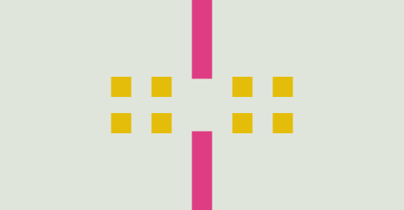
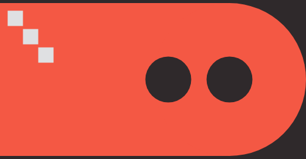
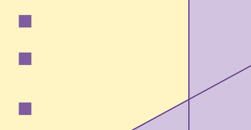

#  physicsplain &ndash; 2D physics in JavaScript

physicsplain is a simple 2D physics library written in JavaScript.  The library is intended for small browser games and animations.  physicsplain is lightweight in memory footprint and code size.

This library is heavily inspired by Erin Catto's [GDC slides](https://box2d.org/publications/) and [Box2D](https://box2d.org/).  However, it does not provide all functionality that Box2D offers (see limitations below).

## Examples
Below are a few examples as GIF animations.  Check out the [JavaScript examples](https://hemartin.github.io/physicsplain/).

### Example 1

### Example 2

### Example 3

### Example 4

## Using the Library
physicsplain is a set of ES modules without dependencies.  Use it in either of these ways:
- Install it from GitHub with `npm install github:hemartin/physicsplain` and import it with `import { State, Body } from 'physicsplain'`.  This works with bundlers such as Vite.
- Import it from a CDN without installing anything: `import { State, Body } from 'https://cdn.jsdelivr.net/gh/hemartin/physicsplain@<tag>/src/physicsplain.js'`, where `<tag>` is a [release](https://github.com/hemartin/physicsplain/releases) tag.

## Development
Requires Node.js 22 or newer.
- `npm ci` installs the development dependencies.
- `npm test` runs the tests.
- `npm run lint` checks the code style ([neostandard](https://github.com/neostandard/neostandard)).
- `npm run test:coverage` runs the tests and prints a coverage report.
- To run the examples locally, serve the repository root with any static web server, e.g. `npx serve`, and open `index.html`.

All changes to `master` go through pull requests, and CI must pass before a pull request can be merged.  Each push to `master` deploys the examples to GitHub Pages.

## Known Limitations
Currently only rectangles are supported as moving bodies. Rectangles, arcs, circles, and floors are supported as fixed bodies. A floor (`FixedFloor`) is a one-sided line: bodies hit it only from its front, the left side when looking from its start to its end, and pass through it from behind.

The following limitations remain:
- Contacts have no friction, so bodies slide freely along each other and along fixed bodies. `lateralFriction` and `rotationalFriction` slow a body down like air drag, not like friction between surfaces. For example, a stack of slightly rotated boxes slides apart.
- Collisions are checked once per step (10 ms), so a fast body can pass through a thin body without touching it. Only a `FixedFloor` pushes back bodies that crossed it during the last step.

Consider using Box2D or other physics libraries if your project is impacted by these limitations.

## Acknowledgments
This project was inspired by the following projects and websites:
- Erin Catto's [GDC slides](https://box2d.org/publications/) and [Box2D](https://box2d.org/)
- Physics simulations at [myPhysicsLab](https://www.myphysicslab.com/)
- Separating physics and graphics from [Fix Your Timestep!](https://gafferongames.com/post/fix_your_timestep/)
- Union-Find algorithm from [Algorithms, 4th Edition](https://algs4.cs.princeton.edu/home/) and [Wikipedia](https://en.wikipedia.org/wiki/Disjoint-set_data_structure)
